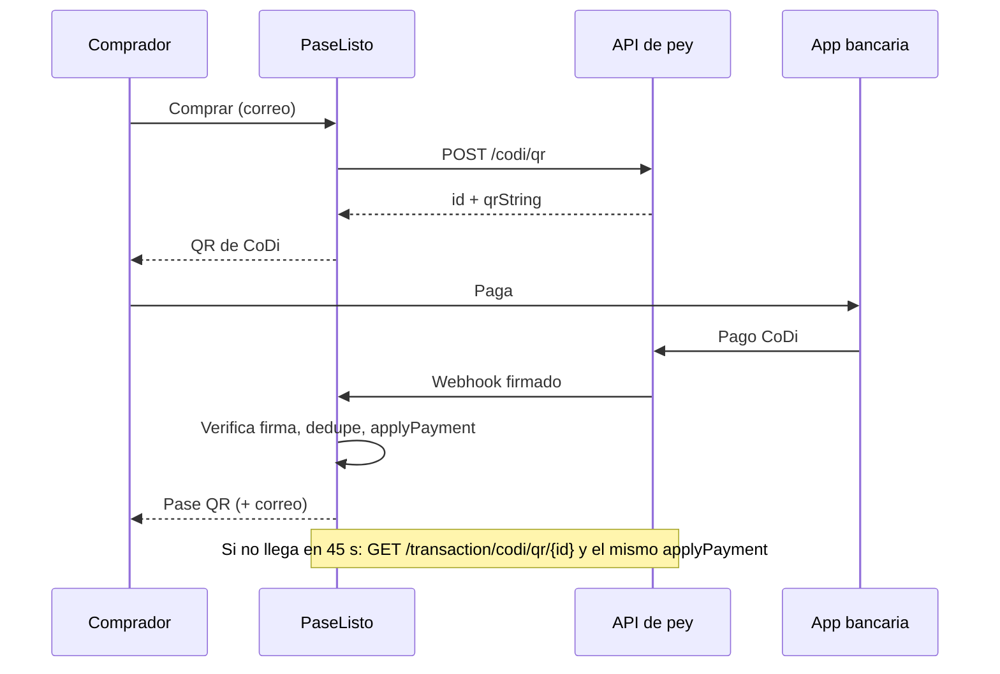

# PaseListo

> **Dejamos de aceptar capturas como prueba de pago.**

En vivo: **https://paselisto.vercel.app** · Repo: https://github.com/davidmferz/paselisto

PaseListo es un proyecto independiente, hecho para el hackatón. No es un producto oficial de pey, de Banxico ni de ningún banco; usamos sus servicios públicos como terceros.

## El problema

- Los organizadores de talleres y eventos pequeños cobran por transferencia y validan con una **captura de pantalla** que cualquiera puede falsificar.
- Conciliar pagos contra el estado de cuenta es manual, lento y propenso a errores.
- En la puerta no hay forma rápida de saber si un boleto es válido o ya se usó.

## La solución

Cobramos con CoDi y el pago **confirma solo**, sin capturas:

```
link del taller → compra (correo) → QR de CoDi → webhook firmado de pey → pase QR → escaneo de un solo uso
```

El comprador paga desde su app bancaria; cuando el pago llega, el servidor valida la firma, marca la orden como pagada y emite un pase QR único. En la puerta, el organizador lo escanea y el pase se consume una sola vez.

## Cómo usamos la API de pey

Todo el código está en `src/shared/adapters/pey-client.ts` y `src/features/webhook/handle-payment.ts`.

1. **`POST /codi/qr`** crea el cobro. Enviamos `amount` en MXN (convertido desde centavos enteros), `expiration` de al menos 360 s, `metadata.orderId` para correlacionar y `generateImage: false`. Con el `qrString` que regresa, **renderizamos nosotros el QR** (librería `qrcode`).
2. **Webhook `codi.qr.payment_received`** (`/api/webhooks/pey`). Verificamos la firma con **Standard Webhooks** (`webhook-id`, `webhook-timestamp`, `webhook-signature`) sobre el **cuerpo crudo**, antes de parsear. Firma inválida responde 401.
3. **Deduplicación por `webhook-id`**: se registra dentro de la misma transacción que marca el pago. Un reintento de pey devuelve `duplicate` y no emite un segundo pase.
4. **Respaldo con `GET /transaction/codi/qr/{id}`**: si pasan 45 s sin webhook, la pantalla de la orden consulta el estado. Webhook y respaldo llaman a la **misma función idempotente `applyPayment`**, así que da igual quién llegue primero.
5. **`createPush` (`POST /codi/pn`)**: adaptador listo para cobro por notificación push a un celular (venta en puerta); aún no está expuesto en la interfaz.

**Probado en producción con un pago real de $0.01 MXN:** el polling y el webhook llegaron con 0.6 s de diferencia y resultó en **un solo pase**. La idempotencia no es teoría.

## Funcionalidades

**Comprador**
- Página pública por taller con precio, fecha, lugar y organizador.
- Compra con correo, QR de CoDi con cuenta regresiva y confirmación automática.
- Guía para pagar con CoDi desde el celular (abrir app del banco, pegar o escanear).
- Pase QR descargable, calendario `.ics` y enlace a Google Calendar.
- Correo de confirmación con el pase vía Resend (el plan gratuito de Resend solo entrega a correos permitidos en su sandbox).

**Organizador** (`/admin`, con contraseña)
- **Mis talleres** y **Nuevo taller** (crear talleres está detrás del flag de servidor `FEATURE_CREATE_EVENTS`).
- Panel por taller con contadores coherentes (pagados, pendientes, en revisión, cupo).
- Escáner con la cámara, resultados congelados en pantalla hasta confirmar, y aviso **"Otro taller"** cuando el pase es de otro evento **sin consumirlo**.

## Arquitectura

Hexagonal ligera por funcionalidad:

```
src/features/<dominio>/   reglas puras + casos de uso (checkout, webhook, checkin, events, organizer, calendar, email, passes)
src/shared/ports.ts       contratos (repo, pey, mailer, reloj)
src/shared/adapters/      pey-client, neon-repo, resend-mailer
src/app/                  Next.js 16 App Router (páginas y rutas API)
src/components/           UI (shadcn/ui, Tailwind v4)
db/schema.sql             esquema Postgres
```

- **Next.js 16 (App Router)** en Vercel, runtime Node.
- **Neon Postgres** con SQL directo (sin ORM). La capacidad se protege con `SELECT … FOR UPDATE` sobre el taller.
- **Canje atómico**: `UPDATE … WHERE used_at IS NULL AND event_id = …`; si dos escáneres leen el mismo pase, solo uno gana.



## Seguridad

- Firma de webhook verificada sobre el cuerpo crudo; si falla, 401.
- Idempotencia: dedupe por `webhook-id` y transición de estado dentro de una transacción con bloqueo.
- Sesión de organizador en cookie firmada con HMAC-SHA256 y comparación con `timingSafeEqual`.
- Sin secretos en el repo: `.env*` está en `.gitignore`; las variables necesarias se listan en la sección «Correr localmente».
- Dinero en **centavos enteros**; la conversión a pesos ocurre únicamente en el cliente de pey.
- Pagos con monto distinto, tardíos o sin cupo pasan a revisión en vez de emitir pase.

## Pruebas

Desarrollo con **Strict TDD** (primero la prueba que falla). Vitest, ~285 pruebas. Las pruebas de integración contra Postgres solo corren si existe `DATABASE_URL`.

```bash
pnpm vitest run
```

## Correr localmente

Variables de entorno (solo nombres; crea tu `.env.local`):

| Obligatorias | Opcionales |
| --- | --- |
| `PEY_API_KEY`, `PEY_WEBHOOK_SECRET`, `DATABASE_URL`, `ORGANIZER_PASSWORD`, `SESSION_SECRET`, `APP_URL`, `EVENT_SLUG`, `EVENT_NAME`, `EVENT_PRICE_CENTS`, `EVENT_CAPACITY` | `PEY_BASE_URL`, `EVENT_DATE`, `EVENT_VENUE`, `EVENT_ORGANIZER`, `EVENT_CONTACT`, `EVENT_STARTS_AT`, `FEATURE_CREATE_EVENTS`, `RESEND_API_KEY`, `EMAIL_FROM`, `EMAIL_ENABLED` |

```bash
pnpm install
pnpm db:migrate
pnpm dev
```

Notas: pey **no tiene sandbox**, así que se prueba con un pago real de $0.01. Cada API key admite **un solo webhook**; apúntalo a una URL pública (por ejemplo `https://<tu-dominio>/api/webhooks/pey`). Sin `RESEND_API_KEY` y `EMAIL_FROM`, el correo se omite sin error.

## Instrucciones de prueba para el jurado

1. Abre https://paselisto.vercel.app y entra al taller de demostración.
2. Compra con **tu correo real** (ahí llega el pase).
3. Paga **$0.01 MXN** escaneando el QR de CoDi o siguiendo la guía móvil desde una app bancaria con CoDi.
4. En segundos la pantalla confirma el pago y muestra tu **pase QR**. Descárgalo y prueba **Agregar al calendario** (.ics o Google).
5. Entra a `/admin` con las credenciales que van en el **formulario de envío** (no están en el repo). Revisa el panel del taller: tu orden aparece como pagada y los contadores cambian.
6. En `/admin/scan` escanea el pase (o pega el código a mano): la primera vez es **válido**; la segunda dice **ya usado**.
7. Opcional: el pase de otro taller muestra **"Otro taller"** sin consumirse.

Nota: el correo de confirmación puede no llegar si tu dirección no está permitida en el sandbox gratuito de Resend; el pase siempre está en pantalla.

## Componentes de terceros

| Componente | Uso | Licencia |
| --- | --- | --- |
| Next.js 16, React 19 | framework | MIT |
| Tailwind CSS 4, shadcn/ui, @base-ui/react | estilos y UI | MIT |
| @neondatabase/serverless, ws | cliente Postgres | MIT |
| qrcode, @zxing/browser | generar y leer QR | MIT |
| standardwebhooks | verificar firmas | MIT |
| resend | correo transaccional | MIT |
| vitest, tsx | pruebas y scripts | MIT |

Servicios: API de pey (cobros CoDi) y CoDi de Banxico, usados como terceros. Tipografías: Bricolage Grotesque, DM Sans y JetBrains Mono (SIL Open Font License).

No usamos código previo al hackatón: el historial de git comienza el 2026-11-14.

## Equipo y licencia

[Completar]
